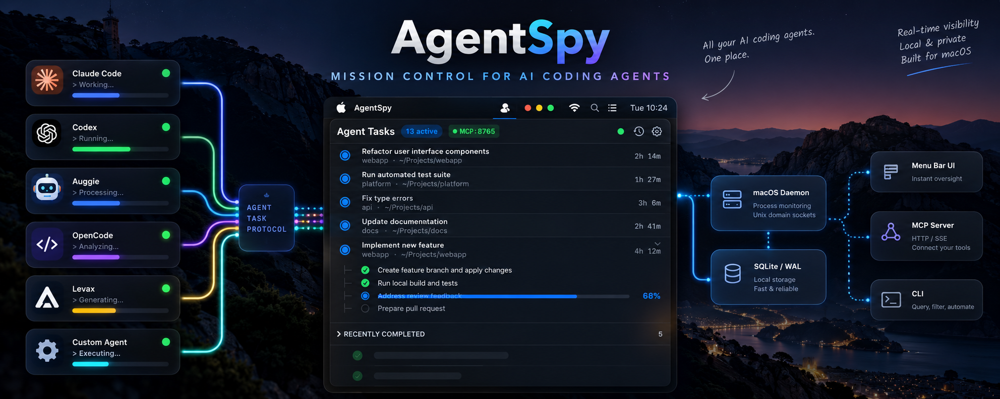

# AgentSpy (Agent Task Monitor)

A high-performance, native macOS menu bar application providing real-time mission control for local AI coding agents (Claude Code, Antigravity, Codex, Auggie, OpenCode, Levax, and custom agents).

## Architecture

```text
Agent / Tool (Claude, Antigravity, CLI, MCP)
          │
          ▼
   Agent Task Protocol (ATP v1)
          │
          ▼
      agenttaskd
   (Local macOS background daemon)
    ┌─────┴─────────────────┐
    ▼                       ▼
 SQLite (WAL)         Process Monitor (sysctl)
    │                       │
    └──────────┬────────────┘
               ▼
       Unix Domain Socket (NDJSON)
               │
               ▼
     AgentSpy (Menu Bar Extra)
```

## Features

- **Native macOS Menu Bar App**: Built with Swift, AppKit bridging, and SwiftUI popover. Runs as an unprivileged menu bar extra (`LSUIElement = true`) with zero Dock clutter.
- **Dynamic Status Indicator**: Menu bar icon updates dynamically based on system state:
  - `Idle`: No active work (`sparkles`)
  - `Active`: One or more running tasks (`circle.inset.filled`) + optional count badge
  - `Attention`: One or more tasks waiting for developer input (`exclamationmark.circle.fill`)
  - `Disconnected`: Daemon disconnected (`bolt.slash`)
- **Semantic Task Hierarchy**: First-class support for root tasks and expandable/collapsible nested subtask trees with live timers, progress bars, and unit counts.
- **Authoritative Process Liveness**: Deep integration with Darwin `sysctl` (`KERN_PROC_PID`) capturing process start timestamps (`p_starttime`) to prevent PID recycling false-positives and automatically reconcile lost processes after a configurable grace period.
- **Local-First SQLite Storage**: WAL-mode database adhering strictly to the design bundle schema (`sessions`, `tasks`, `task_events`, `process_bindings`, `task_actions`).
- **Built-in MCP Server**: Native HTTP and Server-Sent Events (SSE) Model Context Protocol server embedded directly in the macOS menu bar application with live status indicators and custom port control.
- **Comprehensive CLI Tool**: `agenttask` command for scripting, automation, wrapping child commands (`agenttask run`), and manual task management.

## Installation

1. Open `dist/AgentSpy.dmg`.
2. Drag `AgentSpy.app` into `/Applications`.
3. Launch `AgentSpy.app`. The menu bar item will appear automatically.

## CLI Usage

The bundled CLI tool `agenttask` can be invoked directly:

```bash
# Start a new session
agenttask session start --agent claude --project "$PWD" --title "API Refactor"

# Start a root task
agenttask start --title "Implement Feature" --project "$PWD"

# Start a child subtask
agenttask start --parent "<ROOT_TASK_ID>" --title "Run test suite"

# Report measurable progress (fraction and/or units)
agenttask progress "<TASK_ID>" --fraction 0.63 --completed 504 --total 800 --message "Step 504/800"

# Request developer attention / input
agenttask waiting "<TASK_ID>" --reason "Approve breaking API change"

# Complete or fail a task
agenttask done "<TASK_ID>" --summary "All tests passing"
agenttask fail "<TASK_ID>" --reason "Out of memory"

# Run a child command with automatic PID binding and lifecycle tracking
agenttask run --title "Build Project" -- make build

# List tasks
agenttask list --active
```

## MCP Integration

AgentSpy runs an embedded HTTP & SSE Model Context Protocol (MCP) server directly inside the app while running in your macOS menu bar. Coding agents connect directly to this active server instance.

To configure your agent (Claude Desktop, Cursor, Windsurf, Antigravity, etc.):

1. Click the **AgentSpy** icon in your macOS menu bar.
2. Select **Preferences** (Settings).
3. In the **MCP Server** section, you will find:
   - Live server status indicator and port configuration (default: `8765`)
   - Active **SSE** (`http://127.0.0.1:8765/sse`) and **HTTP** (`http://127.0.0.1:8765/mcp`) endpoints
   - One-click buttons to copy the exact JSON config for your client (`Copy Claude Desktop JSON`, `Copy Cursor / Windsurf SSE Config`)

## Verification & Testing

Run the full automated test suite:

```bash
swift test
```

Run the end-to-end 10-step MVP demonstration flow:

```bash
./scripts/demo_flow.sh
```
